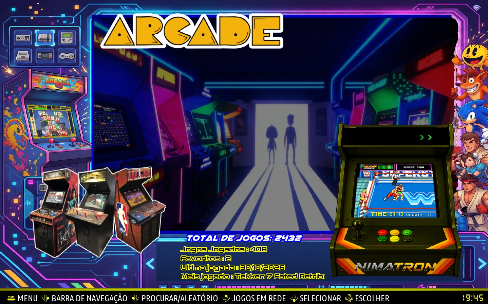
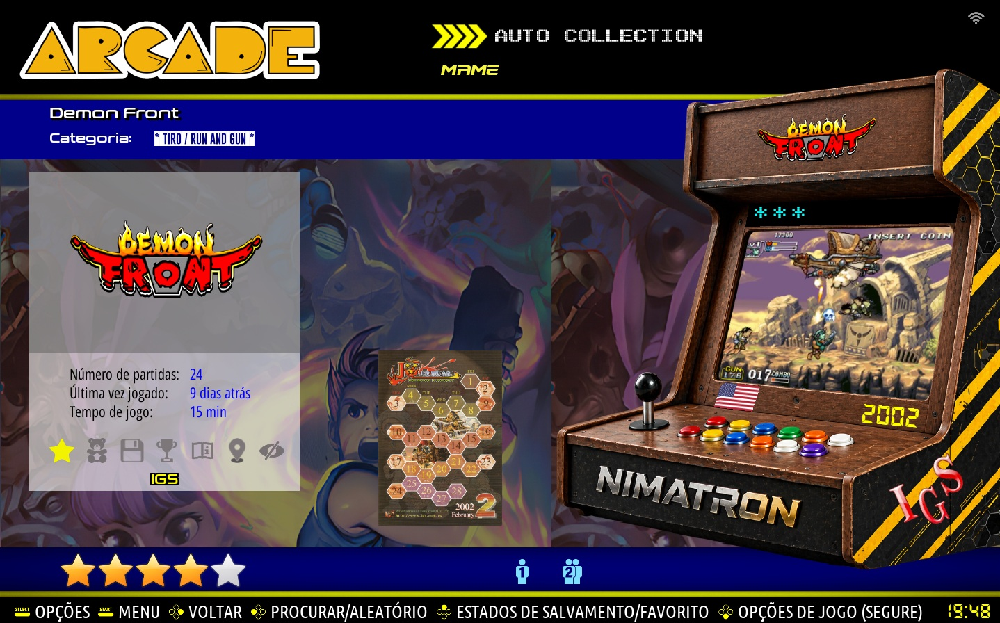

# 🦇 ES-Theme-Nimatron - RetroBat 8

Tema customizado para **RetroBat 8** com shaders GLSL exclusivos, efeito de paralelogramo inclinado e quina elevada.

[RetroBat](https://img.shields.io/badge/RetroBat-8-blue)
[License](https://img.shields.io/badge/License-MIT-green)
[Platform](https://img.shields.io/badge/Platform-Windows-lightgrey)

### ✨ Features

- **Shader GLSL custom** - Efeito de inclinação lateral com elevação de quina
- **2 variações**: `lowerLeftLift` (original) e `lowerRightLift` (invertido)
- **Compatível com RetroBat 8** e Batocera v39+
- **FormatVersion 8** - Uniforms controláveis direto no XML
- **Animações via storyboard**

### 📸 Screenshots





### 📦 Instalação

#### Via RetroBat (Recomendado)
1. Abra o RetroBat
2. Vá em `THEMES DOWNLOADER`
3. Procure por `es-theme-nimatron`

#### Manual
1. Baixe o ZIP do repositório
2. Extraia em `RetroBat/emulationstation/.emulationstation/themes/`
3. Renomeie a pasta para `es-theme-nimatron`
4. Reinicie o RetroBat

### 📥 Baixar
[Download ZIP](https://github.com/sniperbrasil/es-theme-nimatron/archive/refs/heads/main.zip)

Estrutura final:
```
RetroBat/
└── emulationstation/
    └── .emulationstation/
        └── themes/
            └── es-theme-nimatron/
                ├── theme.xml
                ├── shaders/
                │   ├── paralelogramo.glsl
                │   └── paralelogramo_invertido.glsl
                └── art/
```

### 🎨 Como usar os Shaders

No seu `theme.xml`:

```xml
<theme>
    <formatVersion>8</formatVersion>
    <view name="system">
        <image name="logo" extra="true">
            <pos>0.30 0.40</pos>
            <size>0.40 0.40</size>
            <path>./art/logo.png</path>
            <shader>./shaders/paralelogramo.glsl</shader>
            <side>0.25</side>
            <lowerLeftLift>0.12</lowerLeftLift>
            <leftSize>0.50</leftSize>
        </image>
    </view>
</theme>
```

**Uniforms disponíveis:**
- `side` - Inclinação do paralelogramo (0.0 = reto)
- `lowerLeftLift` / `lowerRightLift` - Altura da elevação da quina
- `leftSize` / `rightSize` - Área afetada (0.2 = só lateral, 1.0 = tudo)

**Versão invertida (quina direita):**
```xml
<shader>./shaders/paralelogramo_invertido.glsl</shader>
<lowerRightLift>0.12</lowerRightLift>
<rightSize>0.50</rightSize>
```

**Animado:**
```xml
<storyboard>
    <animation property="side" from="-0.25" to="0.25" duration="2000" mode="easeInOut" repeat="infinite" repeatMode="reverse" />
</storyboard>
```

### 🛠️ Desenvolvimento

```bash
git clone https://github.com/sniperbrasil/es-theme-nimatron.git
cd es-theme-nimatron
# edite e depois
git add .
git commit -m "minha alteração"
git push
```

### 🙏 Agradecimentos

Agradecimentos especiais a quem ajudou e inspirou este projeto:

- **[Snapouille](https://github.com/Snapouille)** - Pelo trabalho no RetroBat e suporte com shaders
- **[BobMoraneRetro](https://github.com/BobMoraneRetro)** - Pelos temas e referências
- **[marcoriesco](https://github.com/marcoriesco)** - Pelas contribuições e ideias

### 📄 Créditos

- Criado por **sniperbrasil**
- Baseado no EmulationStation do Batocera/RetroBat
- Shader original por sniperbrasil

### 📝 Licença

MIT License - Pode usar, modificar e distribuir livremente.

---
Feito com ❤️ para a comunidade RetroBat Brasil
